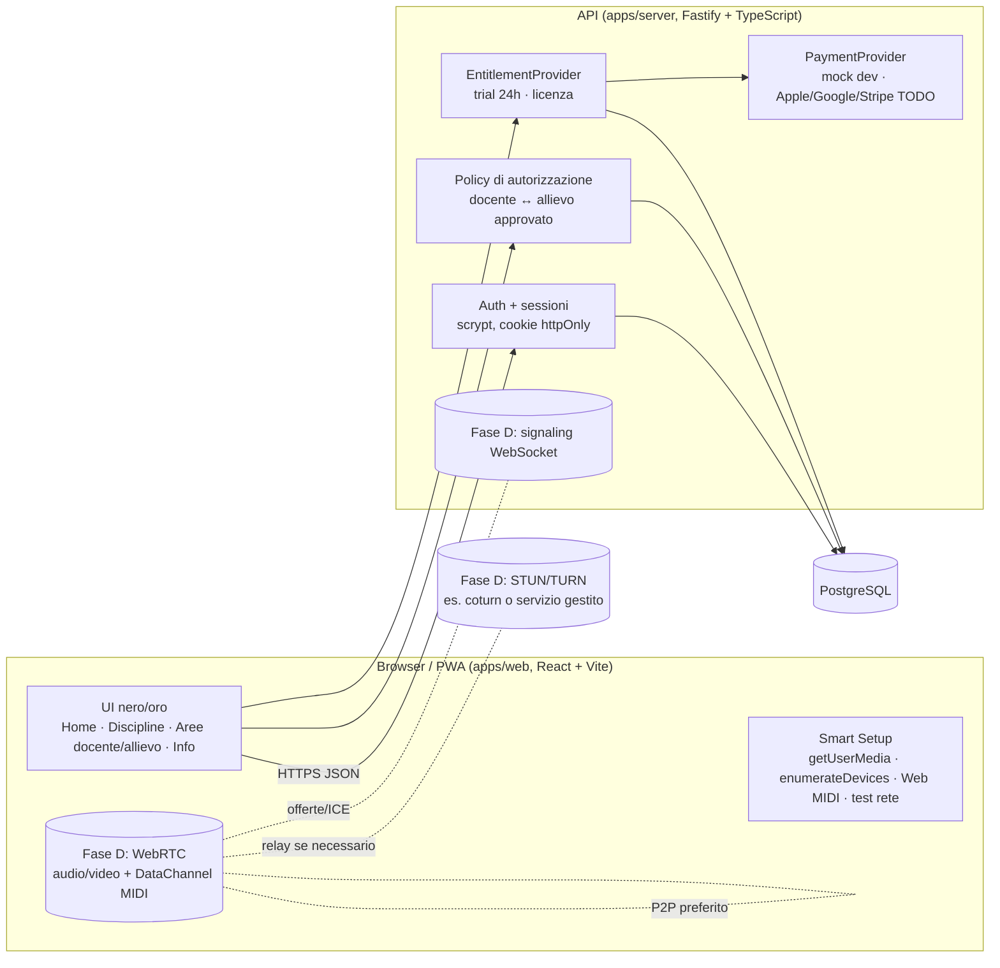

# Architettura — FPM Accademia Musicale Online

Stato: decisione iniziale, 22/11/2026. Fonte dei requisiti: `docs/reference/SPECIFICA_FPM_CONSOLIDATA.md` (prevale su PDF e immagini).

## 1. Decisione

**MVP = web app responsive installabile (PWA) + API Node/TypeScript + PostgreSQL.**
Il packaging nativo (iOS/iPadOS, Android, macOS/Windows) viene **dopo**, solo dove il web non basta.

| Opzione | Pro | Contro | Esito |
|---|---|---|---|
| **Web/PWA (scelta)** | Un solo codice per docente (Mac/Windows/iPad) e allievo (iPhone/Android/tablet/desktop); WebRTC, getUserMedia, Web Audio nativi del browser; distribuzione immediata, niente revisione store per iterare | Web MIDI assente in Safari/iOS; scelta uscita audio limitata fuori da Chromium; vincoli di background su iOS | MVP |
| Capacitor (web + guscio nativo) | Riusa il codice web; plugin nativi (CoreMIDI, audio session iOS); pubblicazione sugli store | Plugin MIDI/audio da scrivere o valutare; acquisti in-app obbligati dalle regole store | Fase successiva per iOS/Android |
| React Native / Flutter | UI nativa | WebRTC e MIDI comunque tramite librerie terze; due codebase (web + app) | Scartata per ora |
| Electron/Tauri (desktop) | Accesso audio/MIDI completo sul computer del docente, routing (es. Logic Pro) | Altra distribuzione da firmare/notarizzare | Valutare per la regia docente pro |

## 2. Componenti

Moduli:
- `packages/shared` — catalogo discipline, schemi di validazione (zod), costanti di brand/commerciali, registro stato funzioni. Usato da client e server.
- `apps/server` — API REST. Ogni rotta verifica ruolo e relazione docente↔allievo **lato server** (`src/policy.ts`). Tempi (trial, inviti, sessioni) calcolati con `now()` di PostgreSQL.
- `apps/web` — SPA React; nessuna logica di autorizzazione affidata al client.

## 3. Stack (versioni installate e verificate il 22/11/2026)

Node ≥ 22.12 · TypeScript 6.0 (strict) · Fastify 5 · @fastify/cookie, @fastify/rate-limit · pg 8 · zod 4 · React 19 · react-router 8 · Vite 8 · Vitest 5 · Playwright 1.63 · ESLint 10 + typescript-eslint 8.
Scelta TypeScript 6.0 e non 7: typescript-eslint dichiara supporto `<6.1`.
Password: `scrypt` della libreria standard di Node (nessuna dipendenza nativa). Nessun font o CDN esterno.

## 4. Sicurezza

- Sessione: token casuale 256 bit in cookie `httpOnly`, `SameSite=Lax`, `Secure` in produzione; nel DB solo l'hash SHA-256.
- CSRF: richieste che modificano dati richiedono header `x-fpm-client: web` e Origin uguale a `WEB_ORIGIN`.
- Rate limit: login/registrazione 10/min, riscatto codice 10/15 min, cancellazione account 5/15 min (in memoria: per più istanze serve uno store condiviso, es. Redis).
- Codici invito: 10 simboli Crockford base32 (50 bit), salvati solo come hash, scadenza, revoca, numero di usi, approvazione obbligatoria del docente. Messaggio d'errore unico per codice errato/scaduto/revocato/esaurito.
- Un allievo ha al massimo un collegamento attivo (indice univoco parziale): vede solo il proprio docente.
- Log senza IP, cookie, corpo delle richieste o email.

## 5. Media in tempo reale (Fase D, progettazione)

- **WebRTC** per audio/video; **DataChannel** (ordinato, affidabile per note-on/off, non affidabile per CC continui) per gli eventi MIDI con numero di sequenza e timestamp del mittente.
- **Signaling**: WebSocket autenticato sulla stessa API; stanza = lezione; l'accesso richiede collegamento approvato.
- **STUN/TURN**: il P2P non riesce sempre (NAT simmetrici, reti aziendali, alcuni operatori mobili). Serve TURN con credenziali temporanee (REST API secret). Senza TURN configurato l'app funzionerà solo in demo locale, dichiarata come tale.
- **Audio musicale**: Opus fullband stereo, `echoCancellation/noiseSuppression/autoGainControl` disattivabili (modalità musica, con cuffie), priorità audio su video (`degradationPreference`, bitrate video adattivo).
- **Misure**: `RTCPeerConnection.getStats()` → RTT, jitter, perdita pacchetti, mostrati in lezione. La latenza zero non esiste; l'accompagnamento perfettamente simultaneo a distanza non è garantito.
- **Basi (Fase E)**: file precaricato su entrambi i dispositivi; comandi con orario di esecuzione futuro sincronizzato (stima offset orologi via ping) e conferma dello stato; la voce live resta soggetta a latenza.
- **Batteria (Fase G)**: 1–4 camere per lato come tracce/peer separati, simulcast/limiti di bitrate, audio prioritario; probabile necessità di più dispositivi o di un computer. Da misurare prima di dichiararlo disponibile.

## 6. Limiti di piattaforma (da riverificare a ogni rilascio)

- **Web MIDI**: Chromium (desktop/Android) sì; Firefox con permesso; **Safari macOS/iOS no**. Fallback: pianoforte a schermo; su iPad/iPhone eventuale app nativa con CoreMIDI.
- **Scelta uscita audio** (`setSinkId`): Chromium sì; Safari/Firefox limitati → istruzioni per usare le impostazioni di sistema.
- **Rete**: il browser non legge password Wi-Fi né cambia rete; il tipo di connessione è esposto solo da Chromium (Network Information API) e in modo indicativo; un hotspot non è riconoscibile con certezza.
- **iOS**: audio in background e routing limitati per le web app.

## 7. Costi operativi (stime da validare con misure reali)

| Voce | A carico di | Note |
|---|---|---|
| Traffico Internet / dati mobili | Utente | Videolezione WebRTC tipicamente ~1–3 Mbit/s per direzione; 4 camere batteria molto di più |
| Hosting API + PostgreSQL | Piattaforma | Piccola VM o PaaS + DB gestito: decine di €/mese all'inizio |
| Signaling | Piattaforma | Leggero, sulla stessa API |
| TURN relay | Piattaforma | Costo proporzionale al traffico che passa dal relay (solo quando il P2P fallisce); va misurata la percentuale reale di sessioni relay |
| Store | Piattaforma | Commissioni Apple/Google sulle vendite in-app; account sviluppatore annuali (Apple) / una tantum (Google) |

Il modello senza abbonamento (licenza €99,90 una tantum) deve coprire costi ricorrenti di hosting e TURN: va verificato con dati reali d'uso prima del lancio.
